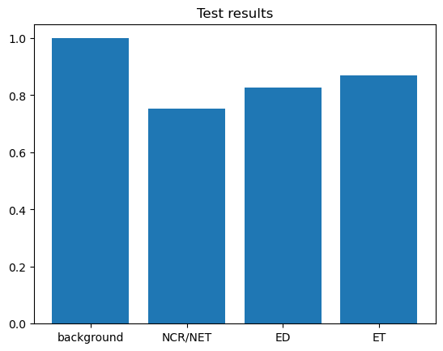
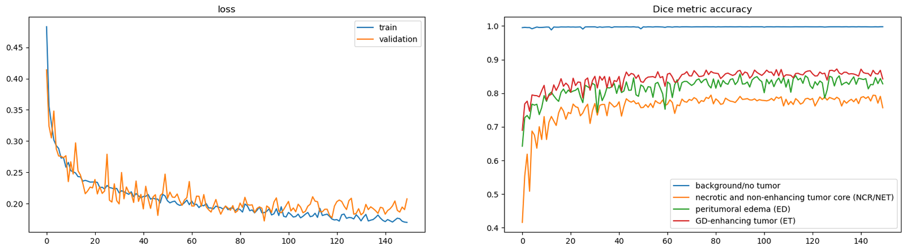

# MRI Image Segmentation using 3D U-Net

Detection and segmentation of brain tumors from multi-modal 3D MRI scans with a 3D U-Net
implemented from scratch in PyTorch and trained on the BraTS 2021 dataset. This is my bachelor's
thesis project.

The network labels every voxel of a brain scan as background or as one of three tumor
sub-regions, so it finds the tumor and also outlines its internal structure.

## Results

Evaluated on **187 held-out patients**, using the full 3D volumes (not cropped patches):

| Region | Dice score |
|---|---|
| Necrotic and non-enhancing tumor core (NCR/NET) | 75.17% |
| Peritumoral edema (ED) | 82.74% |
| GD-enhancing tumor (ET) | 87.01% |
| **Mean over the three tumor regions** | **81.64%** |
| Background / no tumor | 99.92% |

Test loss (Dice + cross-entropy): 0.164.



The enhancing tumor is segmented best, and the necrotic core is the hardest region.

### Training



Training ran for 150 epochs in total. The loss falls steadily from about 0.48 to about 0.17, and the
validation Dice scores level off after roughly 60 epochs. The validation curves are noisy because
each validation sample is a randomly placed patch. The checkpoint with the best validation score
(mean tumor Dice 0.835) was kept for testing.

## Dataset

**BraTS 2021**: 1,251 patients. For each patient there are four MRI modalities and an
expert-annotated segmentation mask, all as 240 × 240 × 155 volumes.

| | |
|---|---|
| Input channels | FLAIR, T1, T1CE, T2 (stacked as 4 channels) |
| Labels | 0 = background, 1 = NCR/NET, 2 = ED, 3 = ET (BraTS label 4 is remapped to 3) |
| Split (by patient, fixed seed) | 876 train / 188 validation / 187 test |

The dataset is not included in this repository.

## Method

### Preprocessing

- **Normalization:** z-score, computed separately for each patient and each modality, using only non-zero voxels. The black space around the brain would otherwise pull the mean and standard deviation toward zero.
- **Patch extraction:** a full volume does not fit in GPU memory, so training uses random 128 × 128 × 128 patches. Patch centers are sampled by label: 10% on background and 30% on each of the three tumor classes. Tumors are small compared with the background, so this makes sure the model sees tumor voxels in almost every batch.
- **Augmentation (training only):** random gamma (brightness) and random elastic deformation, using TorchIO.

### Model

A 3D U-Net written from scratch: three downsampling stages and three upsampling stages, with
skip connections that concatenate encoder features into the decoder.

```
Input (4 × 128 × 128 × 128)
Encoder   32 → 64  |  128  |  256  |  512        (MaxPool3d between stages)
Decoder   ConvTranspose3d upsampling, concatenated with the encoder features
          at each level: 256  |  128  |  64
Output    4 classes per voxel
```

Every convolution is `Conv3d (3×3×3) → BatchNorm3d → ReLU`.

### Loss and training

- **Loss:** Dice loss + cross-entropy (MONAI `DiceCELoss`). Plain cross-entropy can reach a low loss by predicting background everywhere, because the tumor covers a tiny fraction of the volume. Dice loss penalizes missed tumor voxels, and the cross-entropy term keeps early training stable.
- **Optimizer:** Adam, learning rate 2e-4, weight decay 2.3e-5.
- **Hyperparameter search:** random search over learning rate and weight decay, with each trial trained for 5 epochs and compared by validation Dice.
- **Other:** batch size 4, mixed-precision training (AMP).
- **Model selection:** the checkpoint with the best mean Dice over the three tumor classes on the validation set.

### Inference on full volumes

At test time the model predicts the whole 3D volume with a sliding window: 128³ patches with a
16-voxel overlap are predicted and stitched back together, and the overlapping predictions are
averaged. This avoids poor predictions at patch borders, where convolution filters have fewer
neighboring voxels.

## Limitations

- A single train/validation/test split; no cross-validation.
- Only Dice scores are reported, with no boundary-based metrics such as Hausdorff distance.
- Scores are reported for the three annotated sub-regions, not for the standard BraTS combined regions (whole tumor, tumor core, enhancing tumor).

## Run it

```bash
pip install torch nibabel torchio monai matplotlib numpy
jupyter notebook
```

1. Download BraTS 2021 and set `path_dataset` in the notebook to the folder containing the patient directories.
2. Run the notebook from top to bottom. The best model is saved as `best_model.pth`.

A CUDA GPU is required for training.

## Related work

A simplified, 2D slice-classification version of this task, reproducing a published CNN on BraTS 2020, is in the
[Deep-Learning-for-Computer-Vision](https://github.com/AlirezaKalbassi/Deep-Learning-for-Computer-Vision) repository.
